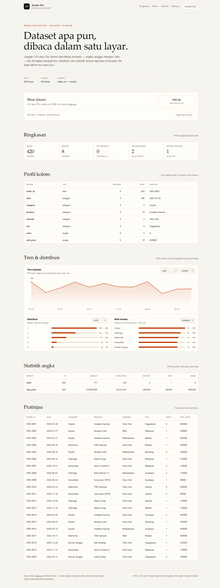

# Analis Set — penjelajah dataset

Dashboard statis untuk membaca dataset apa pun dari CSV/TSV: profil kolom, tren bulanan, distribusi, nilai teratas, statistik angka, dan pratinjau data. Tanpa framework, tanpa database, tanpa dependensi — semua dihitung di browser dan file tidak diunggah ke server.



Data contoh `data/sales.csv` bersifat **sintetis** (420 pesanan, Des 2025 – Nov 2026) dan dibuat ulang dengan `node scripts/generate-data.mjs`.

## Fitur

- Unggah CSV/TSV lewat tombol atau drag-and-drop (maks 10 MB).
- Deteksi pemisah otomatis: koma, titik koma, tab, pipa. Nilai berkutip dan newline di dalam kutip didukung.
- Profil kolom otomatis berdasarkan isi, bukan nama: `angka`, `tanggal`, `kategori`, `teks`.
- KPI, tabel profil, tren bulanan, histogram, nilai teratas, statistik, dan pratinjau 20 baris.
- Pemilih kolom untuk tren, histogram, dan kategori.
- Responsif, semantic HTML, status `aria-live`, hormati `prefers-reduced-motion`.
- Nol permintaan pihak ketiga: tidak ada CDN, font eksternal, atau analytics.

## Jalankan lokal

Butuh server statis karena `fetch` tidak bekerja pada `file://`.

```bash
python -m http.server 8080
# buka http://localhost:8080
```

Atau dengan Node: `npx serve .`

## Pakai dataset sendiri

Klik **Pilih file** di panel "Muat dataset", atau tarik file ke area tersebut. Syarat minimal:

- baris pertama berisi nama kolom;
- minimal satu baris data;
- encoding UTF-8 (BOM didukung);
- maksimal 10 MB dan 50.000 baris dianalisis (sisanya dilaporkan sebagai terpotong).

Aturan deteksi tipe:

| Tipe | Syarat |
| --- | --- |
| `angka` | ≥80% nilai non-kosong bisa diparse. Menerima `Rp`, titik ribuan, dan koma desimal. |
| `tanggal` | ≥80% nilai cocok format ISO `YYYY-MM-DD`, `DD/MM/YYYY`, `MM/DD/YYYY`, atau `YYYY/MM/DD`. |
| `kategori` | ≤50 nilai unik dan ≤50% baris (atau ≤12 nilai unik). |
| `teks` | Sisanya; hanya dihitung, tidak dianalisis. |

Tanggal ambigu seperti `01/02/2026` dibaca **hari-dulu** (1 Februari), mengikuti kebiasaan Indonesia. Kosongkan nilai yang tidak valid atau ubah formatnya jika hasil deteksi meleset.

Batasan yang diketahui:

- Hanya teks UTF-8; file non-UTF-8 akan tampil rusak.
- Excel `.xlsx` tidak didukung — ekspor dulu ke CSV.
- Tipe tidak bisa diubah manual; pemilih kolom hanya menampilkan kolom dengan tipe yang sesuai.

## Struktur

```text
.
├── index.html
├── assets/
│   ├── app.js              # UI: upload, state, render
│   ├── analysis.js         # parser, inferensi, statistik (modul murni)
│   ├── styles.css
│   └── favicon.svg
├── data/sales.csv          # contoh 420 baris
├── scripts/
│   ├── analysis.test.mjs   # node --test
│   └── generate-data.mjs
├── nginx.conf
├── Dockerfile
├── docker-compose.yml
└── docs/preview.png
```

## Test

```bash
node --test scripts/analysis.test.mjs
# atau: npm test
```

## Docker

```bash
docker compose up -d --build
# buka http://localhost:8080
```

Tanpa Compose:

```bash
docker build -t dataset-analis .
docker run --rm -p 8080:8080 --read-only --tmpfs /var/cache/nginx --tmpfs /tmp dataset-analis
```

Praktik container yang diterapkan:

- Base image `nginx-unprivileged` (tag + digest), proses UID 101 non-root.
- `HEALTHCHECK` ke `/healthz`; healthcheck yang sama di Compose.
- `read_only` filesystem, `tmpfs` untuk cache nginx dan `/tmp`, `cap_drop: ALL`, `no-new-privileges`.
- `.dockerignore` kecil; image hanya memuat aset yang disajikan.
- gzip, cache aset 7 hari, HTML revalidasi.
- Header keamanan: CSP `'self'`, `X-Content-Type-Options`, `X-Frame-Options`, `Referrer-Policy`, `Permissions-Policy`; `server_tokens off`.

## Lisensi

MIT — lihat [LICENSE](LICENSE).
